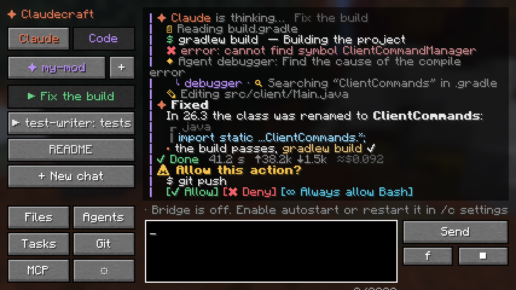
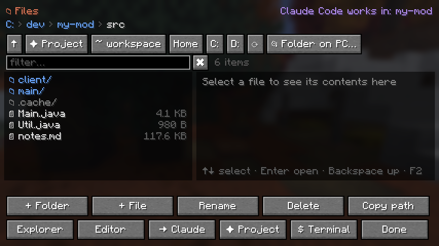
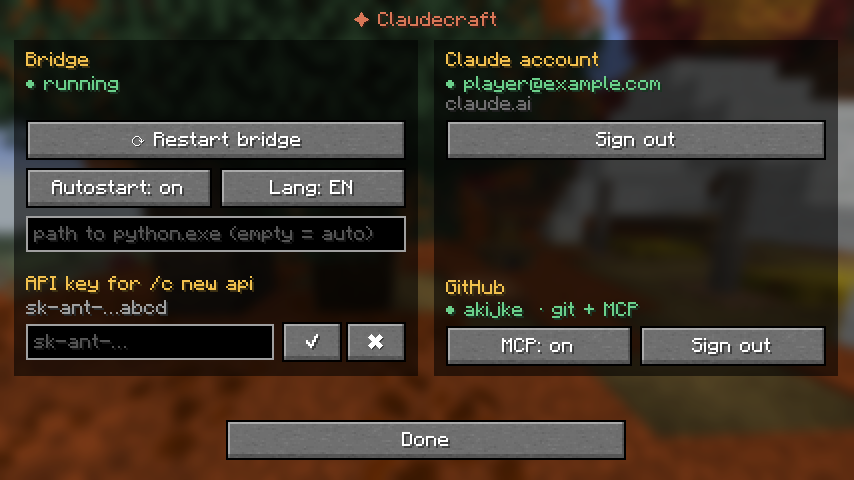
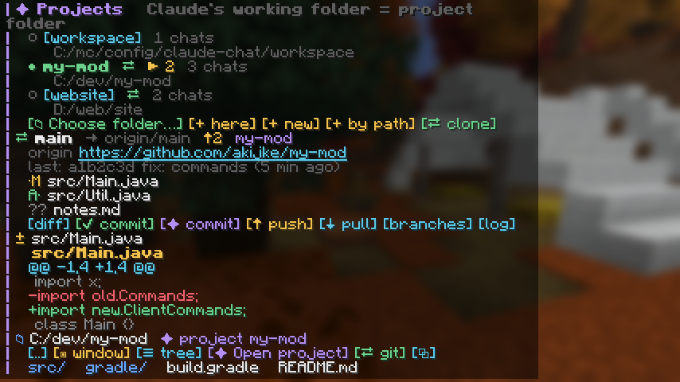
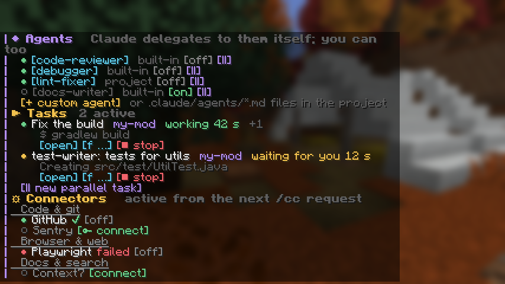

<div align="center">

# ✦ Claudecraft

**Code without leaving Minecraft.**<br>
Claude and Claude Code inside the game: projects, a file manager, a terminal, git,
agents and MCP connectors — all from the chat or a dedicated window.




</div>

---

## What it does

| | |
| --- | --- |
| **Claude & Claude Code** | `/c` for conversations, `/cc` for coding. Answers stream in line by line, with progress lines for every step (reading, editing, running commands), a task plan with checkboxes and a summary with time, tokens and cost. |
| **Talk while it works** | `f <text>` adds a message to the running task without cancelling it — just like typing into Claude Code while it thinks. |
| **Projects** | A project is a folder Claude works in, with its own chats. Pick any folder on your PC with the system dialog; its Claude Code sessions from the terminal or the Claude app show up automatically, and any game chat can be continued on the PC (`claude --resume`). |
| **File manager** | A two-pane window (`/files`) and Linux-style commands: `/ls`, `/cd`, `/cat`, `/tree`, `/find`, `/mkdir`, `/mv`, `/cp`, `/rm`, `/open`, `/code`. Browsing never moves Claude. |
| **Terminal** | `/sh`, `/ps`, `/cmd`, `/bash` run real shell commands with live output, exit codes and a stop button. |
| **Git & GitHub** | Status, colored diffs, log, branches, commit (or let Claude write the commit), push/pull, clone into a new project, create a GitHub repo. Sign in to GitHub from the game. |
| **Agents** | Built-in subagents (code-reviewer, test-writer, debugger, explorer, refactorer, docs-writer, security-auditor, planner, minecraft-modder), your own, and `.claude/agents/*.md` from the project. Run tasks in parallel and manage them in `/cc tasks`. |
| **MCP connectors** | 24 ready connectors: GitHub, GitLab, Sentry, Playwright, Chrome DevTools, Context7, Brave Search, PostgreSQL, MongoDB, Supabase, Kubernetes, Notion, Slack, Figma and more. Keys are entered in a masked window and never reach the chat. |
| **Minecraft dev helpers** | `/cc crash` reads the latest crash report or `latest.log`, explains it and fixes the cause if it is in your project. |
| **Your choice** | English or Russian UI, auto-approve modes, subscription or API key, optional Mod Menu integration. |

<table>
<tr>
<td></td>
<td></td>
</tr>
<tr>
<td align="center"><sub>File manager window</sub></td>
<td align="center"><sub>Settings: bridge, Claude account, GitHub</sub></td>
</tr>
<tr>
<td></td>
<td></td>
</tr>
<tr>
<td align="center"><sub>Projects, git status and a colored diff</sub></td>
<td align="center"><sub>Agents, parallel tasks and MCP connectors</sub></td>
</tr>
</table>

## Install

1. **Minecraft 26.3** with **Fabric Loader 0.20.1+** and **Fabric API 0.165.0+26.3**.
2. Put `claude-chat-1.1.0.jar` into the `mods` folder of that profile.
3. Install **Python 3.11+** (python.org, tick *Add to PATH*). Optional but useful:
   **Git**, **GitHub CLI** (`gh`), **Node.js** (for most MCP connectors).
4. Start the game. The mod unpacks its bridge into `config/claude-chat/runtime`,
   creates a private Python environment, installs dependencies on first start
   (up to a couple of minutes) and runs it. The bridge stops when the game closes.
5. Open `/claude` and press **Sign in: Claude subscription** (or Console/API):
   open the sign-in page, sign in, paste the code. This is the regular
   `claude auth login`, shared with Claude Code in your terminal.
6. Optional: in the same screen press **Sign in with GitHub** for `git push`
   without passwords and the GitHub connector.

Press **K** for the conversation window. `/files` opens the file manager.

<details>
<summary>Build from source</summary>

JDK 25, then from the repository root:

```bash
./gradlew build          # Windows: gradlew.bat build
```

Jars: `build/libs/claude-chat-1.1.0.jar` and `codexcraft/build/libs/codexcraft-1.1.0.jar`.
The bridge can also be started by hand (the mod detects it):
`python bridge/bridge.py --game-dir "<profile folder with mods and config>"`.
</details>

## Commands

Use `/c` (conversation) or `/cc` (Claude Code). Full and short names both work.

**Messages and chats**

| Command | What it does |
| --- | --- |
| `/cc <request>` · `q` · `queue` | Queue a request in the current chat |
| `/cc f <text>` · `force` | Add a message to the running task, without cancelling |
| `/cc cancel` · `restart` · `cq` | Stop and clear the queue · restart keeping history · clear the queue only |
| `/cc c` · `chats` | Chats of the current project; new, rename, status |
| `/cc tokens` | Tokens and estimated cost per chat, project and total; subscription limits |
| `/cc auto off\|edits\|all` | Ask for everything · allow file edits · allow everything |
| `/claude` · **K** | Settings · conversation window |

**Projects, files, terminal**

| Command | What it does |
| --- | --- |
| `/cc project` | Projects; `open`, `pick` (system dialog), `here`, `add`, `new`, `rename`, `remove` |
| `/cc sync` · `/cc pc` | Pull PC sessions of the folder · continue this chat in a terminal on the PC |
| `/files` | File manager window |
| `/ls` `/cd` `/pwd` `/cat` `/tree` `/find` | Browse (`~` workspace, `@` project, `..` up) |
| `/mkdir` `/touch` `/mv` `/cp` `/rm` `/open` `/code` | Change files (`rm` asks first) · open in Explorer / editor |
| `/sh` `/ps` `/cmd` `/bash` `<command>` · `/kill` | Shell commands with live output · stop them |

**Git, agents, connectors**

| Command | What it does |
| --- | --- |
| `/git` | Status: branch, ahead/behind, origin link, changed files (click for diff) |
| `/git diff` `log` `branch` `switch` `stash` | The usual |
| `/git commit <msg>` · `/git commit` | Commit everything · let Claude review the diff and commit |
| `/git push` `pull` `fetch` `clone <url>` `github` | Network ops run in the background; `github` creates the repo with `gh` |
| `/cc agents` · `agent <name> <task>` | Agents · give a task to one |
| `/cc spawn [@agent] <task>` · `tasks` · `stop <id>` | Parallel tasks and the task manager |
| `/cc connectors` · `connect <id>` · `disconnect <id>` | MCP connectors |
| `/cc crash` | Explain the latest Minecraft crash / log |

## How it works

```
Minecraft (Fabric mod)                       Local bridge (Python, 127.0.0.1)
┌────────────────────────────┐   HTTP +      ┌──────────────────────────────────────┐
│ chat commands, buttons,    │   bearer      │ queue per chat, permissions, events  │
│ conversation & file window │ ────────────▶ │ projects · files · shell · git · gh  │
│ settings, folder picker    │ ◀──────────── │ agents · MCP connectors · i18n       │
└────────────────────────────┘   events      └──────────┬───────────────────────────┘
                                                        │ Claude Agent SDK (streaming input)
                                                        ▼
                                            Claude Code CLI  ── shared ~/.claude sessions
```

- The mod only draws UI. Credentials, Claude processes and scheduling live in the bridge.
- `f` writes into the live SDK session. The CLI runs with `--replay-user-messages`
  and a reply ends only when every message sent was acknowledged, so an `f` that
  races with the end of an answer is never lost.
- Sessions are stored by Claude Code itself, so the same session is visible in the
  game, in the terminal and in the Claude app.

## Security

- The bridge listens on `127.0.0.1` only, with a random bearer token; requests with a
  browser `Origin` are rejected.
- Mod commands cannot be triggered by clickable messages from a server.
- Claude and the shell run with the rights of your PC account — no elevation, no UAC bypass.
- Tool calls ask for permission unless you choose an auto-approve mode.
- API keys and connector tokens are stored in `config/claude-chat/secrets.json`
  (owner-only) and never appear in chat events. Do not share `connection.json`,
  `bridge-token`, `secrets.json` or `chats.json`.

## Codexcraft

[`codexcraft/`](codexcraft/README.md) is a companion mod that brings **OpenAI Codex**
into Minecraft the same way (`/gpt`, `/codex`, window on **J**). Both mods run side by side.

## Development

```bash
cd bridge && python -m unittest -v                         # bridge tests
CLAUDECRAFT_CLI_IT=1 python -m unittest test_cli_fake_api  # real Claude CLI vs a local fake API
python -m unittest discover -s codexcraft/tests            # Codexcraft
./gradlew runShots                                         # screenshots of all screens into run/screenshots
```

More: [extensions, permissions, shells and Docker](docs/EXTENSIONS.md).

## Status

Working and tested: the bridge (unit tests and the real Claude Code CLI against a fake
API), the shell on real PowerShell/cmd, GitHub sign-in with the real `gh`, builds for
Minecraft 26.3, and every screen checked on in-game screenshots.

Still to verify in a live world: every button click path, push/clone over the network,
connectors with real keys, Docker and SSH. Interactive terminal programs (vim, password
prompts) are not supported in the in-game shell.

<sub>Not affiliated with Mojang, Microsoft or Anthropic. Minecraft is a trademark of Mojang Studios.</sub>
